# Seattle Airbnb Market Analysis: What Drives Pricing?


> **Business question:** If someone wanted to list their home on Airbnb in Seattle, what factors most influence the price they should charge?

I used PostgreSQL to analyze **6,996 Seattle Airbnb listings** from [Inside Airbnb](https://insideairbnb.com/get-the-data/). The project starts with a first look at the raw data, investigates outliers, builds a cleaned view, and ends with a pricing recommendation query that answers the business question.

---

## The Answer in 30 Seconds

| Factor | What it does | Evidence |
|---|---|---|
| **Room type** | Sets the price *tier* | A 1BR entire home has a **$126** median vs **$74** for a 1BR private room (+70%) |
| **Bedrooms** | Moves price *up the tier* | Each extra bedroom adds about **$55–65** to the median nightly price |
| **Neighbourhood** | Sets the ceiling *and* the occupancy | Top area earns **2.3x** the bottom area ($29,950 vs $12,835 a year) |
| **Host quality** | Barely changes price, multiplies *revenue* | Superhosts charge **12%** more but earn **2.5x** more |
| **Ratings** | **4.7** is the cliff | Below 4.7, average revenue drops from $21,252 to $13,419 |

**Bottom line:** Bedrooms, room type and neighbourhood decide what you can *charge*. Host quality (fast responses, superhost status, a 4.7+ rating) decides how much of that you actually *earn*.

---

## Table of Contents
1. [Data](#data)
2. [Data Cleaning: The $40,000 Hotel Rooms](#data-cleaning-the-40000-hotel-rooms)
3. [Findings](#findings)
4. [SQL Skills Demonstrated](#sql-skills-demonstrated)
5. [Limitations & Next Steps](#limitations--next-steps)
6. [Repository Structure](#repository-structure)
7. [How to Reproduce](#how-to-reproduce)

---

## Data

| Item | Detail |
|---|---|
| **Source** | [Inside Airbnb](https://insideairbnb.com/get-the-data/), Seattle, WA |
| **Snapshot** | December 2025 |
| **License** | Creative Commons Attribution 4.0 International |
| **Tables** | `listingsSEA` (summary file, 18 columns) and `listings_sea_detailed` (detailed file, 35 of 70+ columns kept) |
| **Scale** | 6,996 listings · 3,558 hosts · 17 neighbourhood groups · 88 neighbourhoods |

The summary file has no bedroom, review score or revenue data, so I extracted the full `listings.csv.gz` file and built a second table with the columns needed for pricing analysis. Before loading it, I cleaned the `"N/A"` and blank values in `host_response_rate` and `host_acceptance_rate`.

Full schema: [`sql/create_tables.sql`](sql/create_tables.sql)

---

## Data Cleaning: The $40,000 Hotel Rooms

The first summary query showed a problem right away:

```sql
SELECT
    MIN(price)                                          AS lowest_price,
    MAX(price)                                          AS highest_price,
    ROUND(AVG(price), 2)                                AS avg_price,
    PERCENTILE_CONT(0.5) WITHIN GROUP (ORDER BY price)  AS median_price
FROM listingsSEA
WHERE price IS NOT NULL AND price > 0;
```

| lowest_price | highest_price | avg_price | median_price |
|---:|---:|---:|---:|
| $15 | $50,039 | $571.72 | $149 |

An average nearly **4x the median** means a small group of listings is pulling the mean up. I tracked them down step by step:

1. **Bucketed prices.** 49.6% of listings are $101–200 and only 3.6% are above $500.
2. **Grouped by neighbourhood × room type.** Downtown "Hotel room" listings had a **median of $40,100 a night** (48 listings).
3. **Inspected those rows.** All 48 belonged to **two operators** (RoomPicks and Aishat) advertising multi-unit bundles at $40,000–$50,000. The same two hosts also listed "Entire home/apt" units at those prices.
4. **Found a second issue.** Listings with 30–180 night minimums are long-term leases, not short-term rentals.

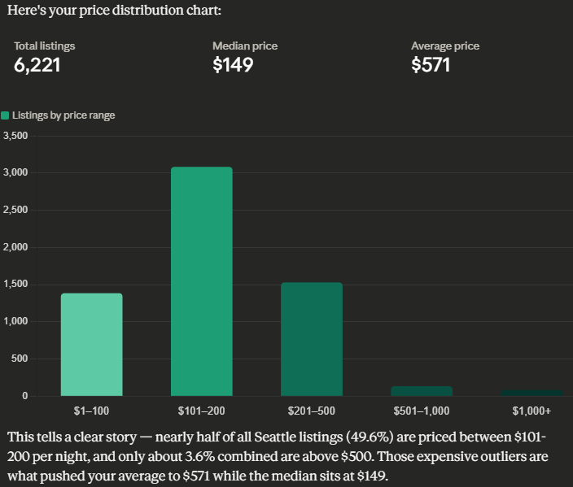

I turned these findings into a reusable view so every analysis query uses the same rules:

```sql
CREATE VIEW clean_listings AS
SELECT *
FROM listings_sea_detailed
WHERE price IS NOT NULL            -- Exclude missing prices
  AND price > 0                    -- Exclude zero-dollar listings
  AND price < 1000                 -- Exclude bogus/inflated prices
  AND room_type != 'Hotel room'    -- Exclude commercial hotel inventory
  AND minimum_nights <= 30;        -- Exclude long-term leases
```

| Rule | Rows flagged | Reason |
|---|---:|---|
| NULL or $0 price | 775 | Can't be used in pricing analysis |
| Price ≥ $1,000 | 91 | Bulk-package listings from two hosts, not real nightly rates |
| Hotel rooms | ~51 | Commercial hotel inventory from the same two hosts |
| Minimum nights > 30 | 342 | Monthly rentals, not the short-term market |
| **Total removed** (rules overlap) | **1,208** | **About 17% of raw rows** |

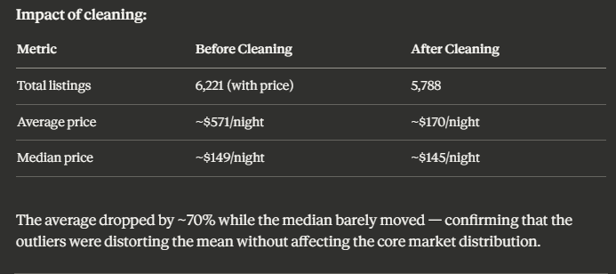

**Result:** The average fell about 70% ($571 → $170) while the median barely moved ($149 → $145). The outliers were distorting the mean, not the core market.

Full investigation: [`sql/cleaning.sql`](sql/cleaning.sql)

---

## Findings

All queries: [`sql/analysis_queries.sql`](sql/analysis_queries.sql)

### 1. Physical features set the price

**Bedrooms show the clearest, most consistent price relationship.** From 1 to 6 bedrooms, each extra bedroom adds about $55–65 to the median nightly price.

| Bedrooms | Listings | Median price |
|---:|---:|---:|
| 1 | 2,677 | $110 |
| 2 | 1,453 | $173 |
| 3 | 738 | $227 |
| 4 | 243 | $295 |
| 5 | 92 | $360 |

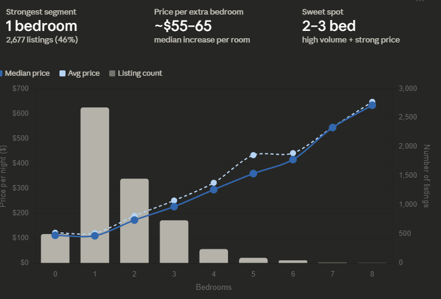

- **Guest capacity** matters, but less: about **$25–30 per extra guest** (2–8 guests). Sofa beds can pad capacity, but not bedroom count.
- **Bathrooms** follow a staircase pattern, with half-baths falling between whole numbers. **63%** of listings have exactly one bath, so a second bath helps a listing stand out.

**The money query: room type × bedrooms**

```sql
SELECT
    room_type,
    bedrooms,
    COUNT(*)                                            AS listings,
    ROUND(AVG(price), 2)                                AS avg_price,
    PERCENTILE_CONT(0.5) WITHIN GROUP (ORDER BY price)  AS median_price
FROM clean_listings
WHERE bedrooms IS NOT NULL
GROUP BY room_type, bedrooms
HAVING COUNT(*) >= 10
ORDER BY room_type, bedrooms;
```

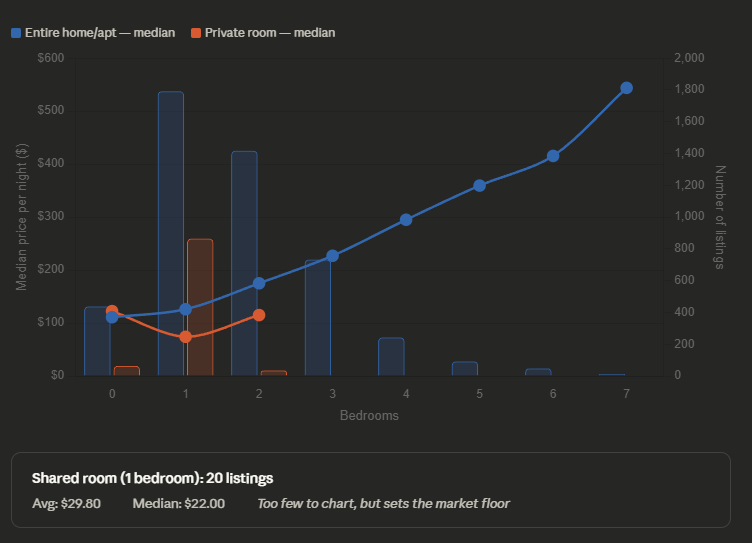

- **Room type is the gate and bedrooms are the escalator.** A 1BR entire home has a $126 median vs $74 for a private room, a $52 "privacy premium."
- **Private rooms stop at about 2 bedrooms** (865 one-bedroom private rooms, only 35 two-bedroom ones). Bedrooms only work as a price lever for entire homes.
- **For a host with a 2BR apartment:** listing the whole place has a $175 median vs $115 for renting out a room, which is **$60 more per night**.

### 2. Host quality drives revenue, not price

| Behavior | Price difference | Revenue difference |
|---|---|---|
| **Superhost** vs not | $150 vs $134 median (**+12%**) | $24,380 vs $9,878 (**2.5x**) |
| **Instant book** on vs off | $183 vs $169 | $19,779 vs $18,376 |
| **Responds within an hour** vs "a few days or more" | $175 vs **$208** | **$20,572** vs $4,061 (**5x**) |

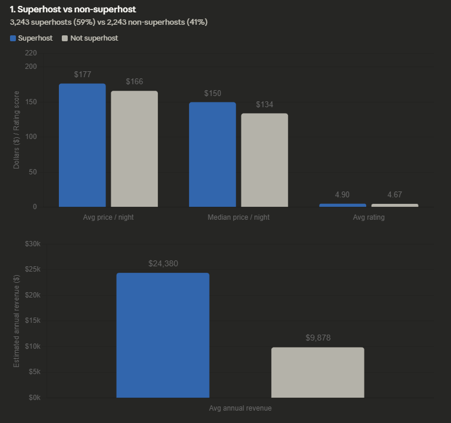

**The response-time paradox:** The slowest responders charge the *most* per night but earn the *least* per year. Their listings likely sit empty while guests book faster hosts. This is the clearest evidence that **price alone doesn't determine earnings**.

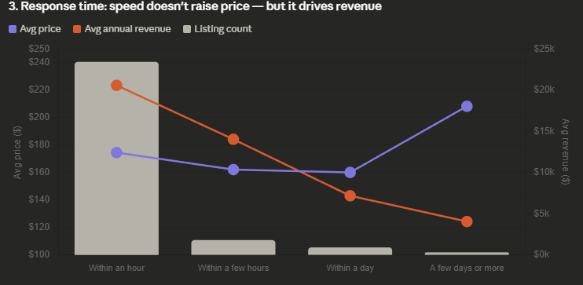

Instant book also works as a sign of a confident, professional host, not as a discount for convenience. Those listings charge *more* and get more recent reviews (21.5 vs 18.6).

### 3. Expensive listings earn more, and location works through occupancy

```sql
SELECT
    CASE
        WHEN price BETWEEN 1   AND 75  THEN '1_budget ($1-75)'
        WHEN price BETWEEN 76  AND 150 THEN '2_mid ($76-150)'
        WHEN price BETWEEN 151 AND 300 THEN '3_upper ($151-300)'
        ELSE '4_premium ($300+)'
    END AS price_tier,
    COUNT(*)                                    AS listings,
    ROUND(AVG(estimated_occupancy_l365d), 0)    AS avg_nights_booked,
    ROUND(AVG(estimated_revenue_l365d), 0)      AS avg_annual_revenue
FROM clean_listings
WHERE estimated_revenue_l365d > 0
GROUP BY price_tier
ORDER BY price_tier;
```

| Price tier | Listings | Nights booked | Annual revenue |
|---|---:|---:|---:|
| Budget ($1–75) | 473 | 128 | $7,230 |
| Mid ($76–150) | 2,074 | **153** | $17,347 |
| Upper ($151–300) | 1,898 | 139 | $27,868 |
| Premium ($300+) | 404 | 101 | **$40,697** |

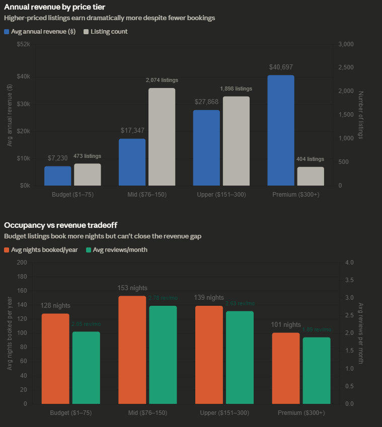

- **Higher booking volume doesn't make up for a low price.** Budget listings book 27% more nights than premium ones but earn 5.6x less.
- **The mid-tier is where most of the market sits.** It has the most listings and the highest occupancy. At about $17K a year, it's a realistic income goal for a typical new host.

**Price rank ≠ revenue rank by neighbourhood:**

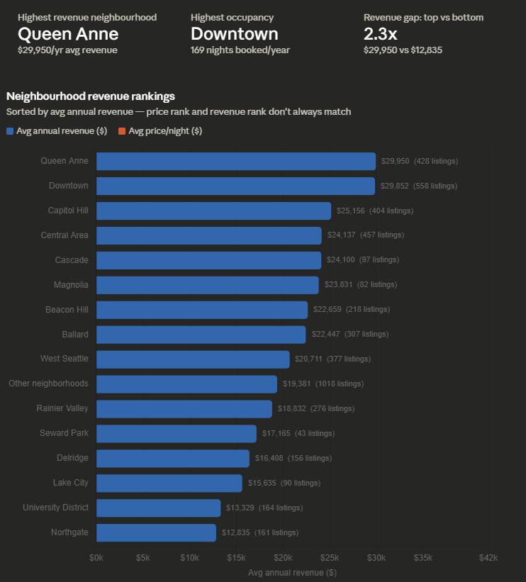

- **Queen Anne** ($29,950) and **Downtown** ($29,852) earn almost the same, but in different ways. Queen Anne has the highest average price ($211). Downtown fills the most nights (169 a year) at $185.
- **Beacon Hill** ranks **7th in revenue** despite being one of the cheaper areas ($159), because it stays booked (149 nights).
- **Lake City** charges more than **Delridge** ($156 vs $132) but earns less, because Delridge books 28 more nights a year.

### 4. Ratings: 4.7 is the cliff

| Rating tier | Listings | Avg price | Avg revenue |
|---|---:|---:|---:|
| Exceptional (4.9–5.0) | 2,726 | $188 | $23,613 |
| Excellent (4.7–4.89) | 1,647 | $160 | $21,252 |
| Great (4.5–4.69) | 487 | $143 | **$13,419** |
| Good (4.0–4.49) | 342 | $130 | $7,353 |
| Below avg (<4.0) | 82 | $128 | $3,799 |

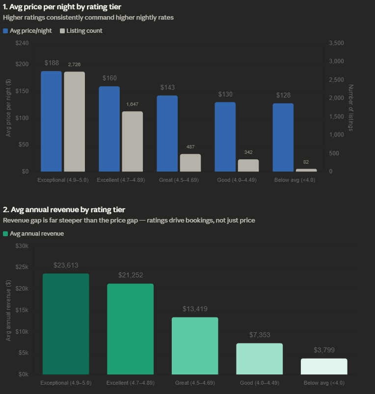

- From the top tier to the bottom, **price differs by 47% but revenue differs by 6.2x**. This is the same pattern as superhosts: quality has a small effect on what you *charge* and a large effect on how often you get *booked*.
- **83% of rated listings score 4.7 or higher.** Dropping below 4.7 puts a listing in the bottom 17%, and average revenue falls from $21,252 to $13,419.
- **Value perception is very consistent:** value scores range only from 4.46 to 4.82 across all 16 areas. Guests in expensive areas expect to pay more. Cascade is the outlier (2nd-highest price per value point, one of the lowest value scores), and Delridge is the best deal.

### 5. Window functions: finding overpriced listings

This query compares each listing to its exact competitive set (same neighbourhood, room type and bedroom count) without collapsing rows:

```sql
SELECT
    name,
    neighbourhood_group,
    room_type,
    bedrooms,
    price,
    ROUND(AVG(price) OVER (
        PARTITION BY neighbourhood_group, room_type, bedrooms
    ), 2) AS comp_avg_price,
    price - ROUND(AVG(price) OVER (
        PARTITION BY neighbourhood_group, room_type, bedrooms
    ), 2) AS vs_competitors,
    COUNT(*) OVER (
        PARTITION BY neighbourhood_group, room_type, bedrooms
    ) AS comp_set_size
FROM clean_listings
WHERE bedrooms IS NOT NULL
ORDER BY ABS(price - AVG(price) OVER (
    PARTITION BY neighbourhood_group, room_type, bedrooms
)) DESC
LIMIT 30;
```

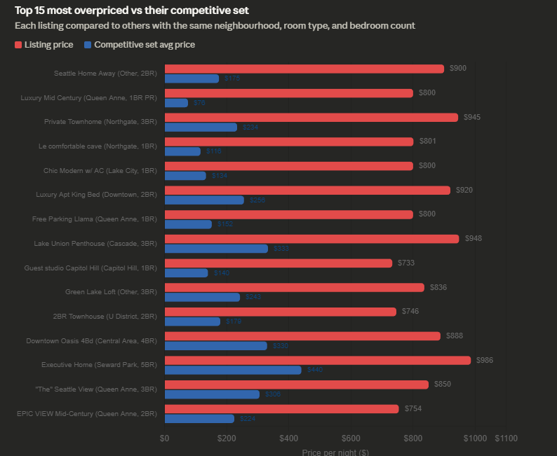

<details>
<summary>View the raw query output in pgAdmin</summary>

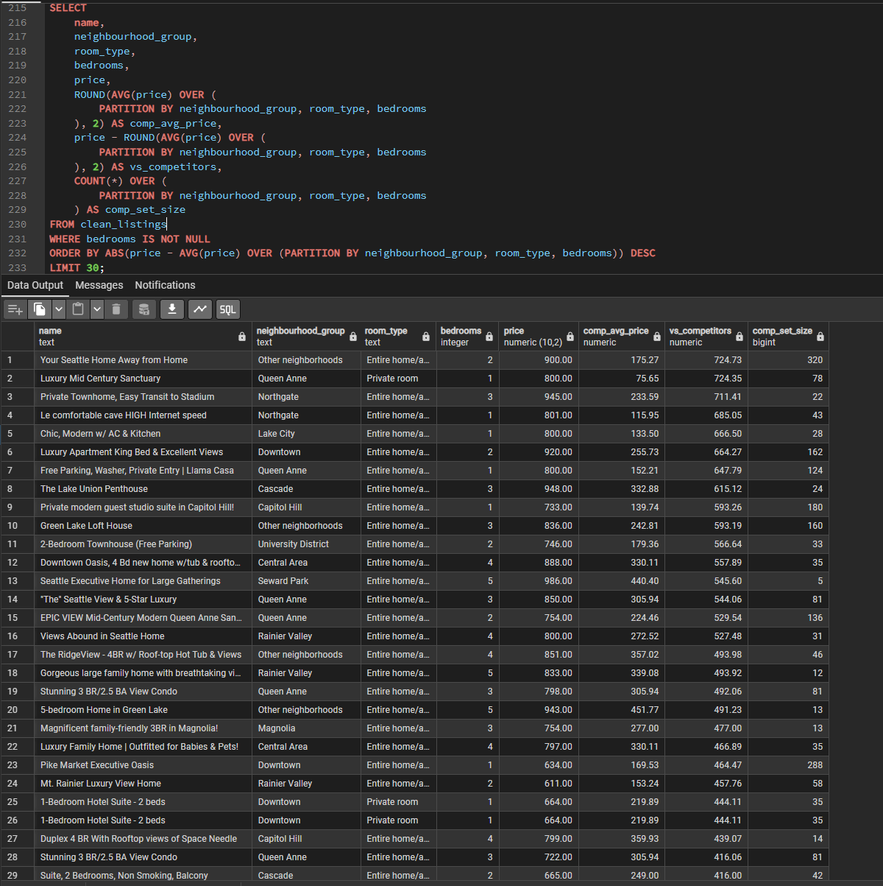

</details>

The top result is a 2BR entire home listed at **$900/night**, while its **320 comparable listings average $175**, or **5.1x the market**. Either the property has features this dataset doesn't capture, or it's overpriced and likely sitting empty.

### 6. The deliverable: a pricing recommendation engine

*"If you have X bedrooms in neighbourhood Y, here's what to charge."*

```sql
SELECT
    neighbourhood_group,
    room_type,
    bedrooms,
    COUNT(*)                                            AS comp_set_size,
    PERCENTILE_CONT(0.25) WITHIN GROUP (ORDER BY price) AS price_25th,
    PERCENTILE_CONT(0.50) WITHIN GROUP (ORDER BY price) AS price_median,
    PERCENTILE_CONT(0.75) WITHIN GROUP (ORDER BY price) AS price_75th,
    ROUND(AVG(review_scores_rating), 2)                 AS avg_rating,
    ROUND(AVG(estimated_revenue_l365d), 0)              AS avg_revenue
FROM clean_listings
WHERE bedrooms IS NOT NULL
  AND estimated_revenue_l365d > 0
GROUP BY neighbourhood_group, room_type, bedrooms
HAVING COUNT(*) >= 5
ORDER BY neighbourhood_group, room_type, bedrooms;
```

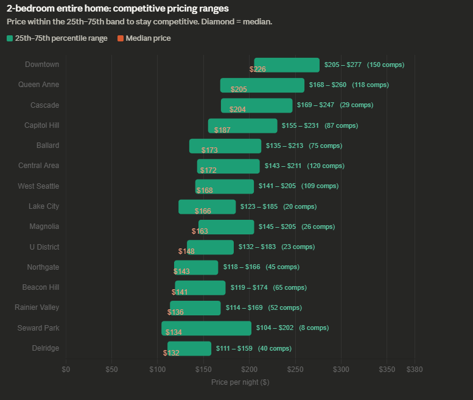

> **Example recommendation:** For a 2BR entire home in Capitol Hill, charge **$155–$231 a night, with $187 as the sweet spot**. Pricing at the 25th percentile beats 75% of competitors on price (good for occupancy). Pricing at the 75th percentile earns more per night but means fewer bookings.

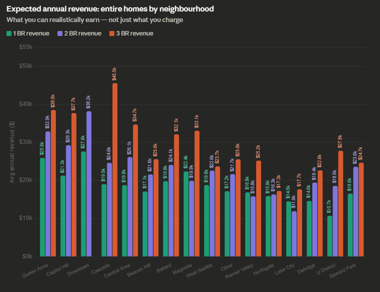

Revenue doesn't always follow price. **Cascade 3BR homes earn about $45,550 a year**, the highest 3BR revenue in the city, even though Cascade isn't the most expensive neighbourhood. **Downtown 2BRs** have both the highest 2BR median price ($226) and the highest revenue (about $38,160).

---

## SQL Skills Demonstrated

| Technique | Where it's used |
|---|---|
| `CREATE TABLE`, data types, CSV import | Two-table schema for the summary and detailed files |
| `CREATE VIEW` | `clean_listings`: one reusable source with documented cleaning rules |
| Aggregation: `COUNT`, `AVG`, `ROUND`, `COUNT(DISTINCT)` | Every section |
| `PERCENTILE_CONT ... WITHIN GROUP` | Medians and 25th/75th percentile pricing bands |
| `CASE WHEN` bucketing | Price tiers, rating tiers, outlier ranges |
| `GROUP BY` multiple dimensions + `HAVING` | Room type × bedrooms; minimum sample sizes for reliability |
| Window functions: `AVG() OVER`, `COUNT() OVER`, `SUM() OVER ()` | Competitive-set comparison; percent of total |
| `NULLIF` | Safe division in the price-per-value-point metric |
| Iterative investigation | Avg vs median → buckets → drill-down → host-level inspection → cleaning rule |

---

## Limitations & Next Steps

**Limitations**
- **Estimated revenue and occupancy are modeled by Inside Airbnb** (largely from review activity), not actual bookings. Listings with more reviews will naturally show higher estimated occupancy, which may overstate the revenue gaps for superhosts, ratings and response time.
- **Correlation, not causation.** Superhosts may earn more because they tend to have better listings, not only because of the badge.
- **Single snapshot.** Prices are listed rates from one scrape (December 2025), so seasonality isn't captured.
- **The $1,000 price cap** removes some legitimate luxury listings along with the bogus ones.

**Next steps**
- [ ] Regression model in R: `price ~ bedrooms * room_type + neighbourhood + accommodates + bathrooms` (with an interaction term, since bedrooms only matter for entire homes)
- [ ] Interactive Tableau Public dashboard for the pricing recommendation engine
- [ ] Add `reviews.csv` to analyze seasonality and booking trends over time

---

## Repository Structure

```
seattle-airbnb-analysis/
├── README.md
├── sql/
│   ├── create_tables.sql       # Schema for both tables
│   ├── cleaning.sql            # Outlier investigation + clean_listings view
│   └── analysis_queries.sql    # Sections 1-6: features, hosts, revenue, ratings, window functions, pricing engine
└── visualizations/
    ├── 01_price_distribution.png
    ├── 02_cleaning_impact.png
    ├── 03_price_by_bedrooms.png
    ├── ...
    └── 13_expected_revenue_by_neighbourhood.png
```

Raw CSVs aren't included because of file size. Download them from Inside Airbnb (see below).

---

## How to Reproduce

1. Download the Seattle `listings.csv` (summary) and `listings.csv.gz` (detailed) files from [Inside Airbnb](https://insideairbnb.com/get-the-data/).
2. Install [PostgreSQL](https://www.postgresql.org/download/) (includes pgAdmin 4) and create a database, e.g. `airbnb_seattle`.
3. Run [`sql/create_tables.sql`](sql/create_tables.sql).
4. Import the CSVs with pgAdmin's Import/Export tool (Header: **ON**, Escape: **"**).
5. Run [`sql/cleaning.sql`](sql/cleaning.sql) to investigate outliers and create the `clean_listings` view.
6. Run [`sql/analysis_queries.sql`](sql/analysis_queries.sql) section by section.

---

## Author

**Mang Suum**: Economics graduate (B.A., Willamette University) building a data analytics portfolio, combining SQL with an economist's focus on markets and pricing.

- [LinkedIn](https://www.linkedin.com/in/mang-suum/)
- [GitHub](https://github.com/mangsuum24)
